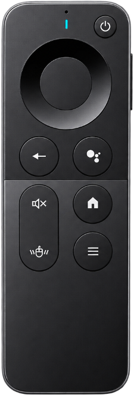

# T1 - 遥控器与飞鼠平滑优化及全键位映射助手 (macOS)

一款专为 macOS 设计的 2.4G 遥控器与空中飞鼠（Air Mouse）体验增强工具。通过多级自适应卡尔曼滤波与阻尼算法消除光标抖动，并支持正面多媒体键与背面 44 键全键盘的深度按键重映射（单击 / 双击 / 长按）。



---

## ✨ 核心特性

### 1. 飞鼠光标平滑滤波 (Feel)
- **微动防抖 (Anti-shake Deadzone)**：智能识别手部微小生理颤动，静止时指针纹丝不动。
- **动态阻尼 (Dynamic Smoothing)**：慢速移动时光滑细腻，大范围甩动时光标随动零延迟。
- **手腕倾斜与非对称补偿**：针对人体工学，内置向右扫动阻尼补偿与轴向灵敏度独立微调。
- **平滑暂停 / 极低开销**：当物理按键按下时自动切入原生模式防误触，无遥控器输入时 CPU 占用近乎为 0。

### 2. 双面全键位深度映射 (Key Mapping)
- **正面 12 颗多功能按键**：方向键（上/下/左/右/确认）、电源、音量加/减、返回、语音、静音、主页/菜单。
- **背面 44 键全键盘支持**：完整覆盖 QWERTY 字符键、数字行、标点符号及 Fn 组合键。
- **多动作手势识别**：
  - **单击 (Single Click)**
  - **双击 (Double Click)**：320ms 窗口自适应连击判定。
  - **长按 (Long Press)**：长按 400ms 触发独立自定义动作。
- **双层按键捕获技术**：同时搭载 CGEventTap 全局底层拦截与设置窗口实时监视器（Local Monitor），录制按键毫秒级响应。
- **分面重置与独立管理**：正面按键与背面全键盘映射独立存储与重置，支持右键一键快捷选键。

### 3. macOS 原生精致体验
- **状态栏常驻 (Menu Bar Resident)**：`LSUIElement` 纯粹后台体验，不占用 Dock 栏。
- **实时 HUD 状态反馈**：录制高亮呼吸灯、预设快捷键、4 秒生效提示横幅与最后按键回显。
- **极简打包发布**：内置完整的代码签名与 `.dmg` 磁盘镜像打包脚本。

---

## 🛠️ 构建与运行

### 系统要求
- macOS Monterey (12.0) 或更高版本
- Xcode Command Line Tools (`swiftc`, `codesign`, `hdiutil`)
- **系统辅助功能权限 (Accessibility)**：首次使用需在「系统设置」→「隐私与安全性」→「辅助功能」中允许 T1。

### 本地编译与打包
```bash
# 赋予脚本执行权限
chmod +x package.sh build_dmg.sh

# 1. 编译并打包应用至 T1.app
./package.sh

# 2. 生成发布版 DMG 镜像 (自动挂载、布局与混淆压缩)
./build_dmg.sh
```

构建完成后将在项目根目录下生成 `T1-v1.0.0.dmg`。

---

## 🔒 权限说明 (macOS Accessibility)
本软件基于 macOS 底层 `CGEvent.tapCreate` 实现飞鼠光标拦截与按键重映射：
- Bundle Identifier 固定为 `local.t1.controller`，请勿随意更改，以防已授权的 TCC 辅助功能权限失效。
- 签名推荐使用本地开发者证书（如 `T1 Developer`）或系统自签名。

---

## 📄 开源许可
MIT License.
